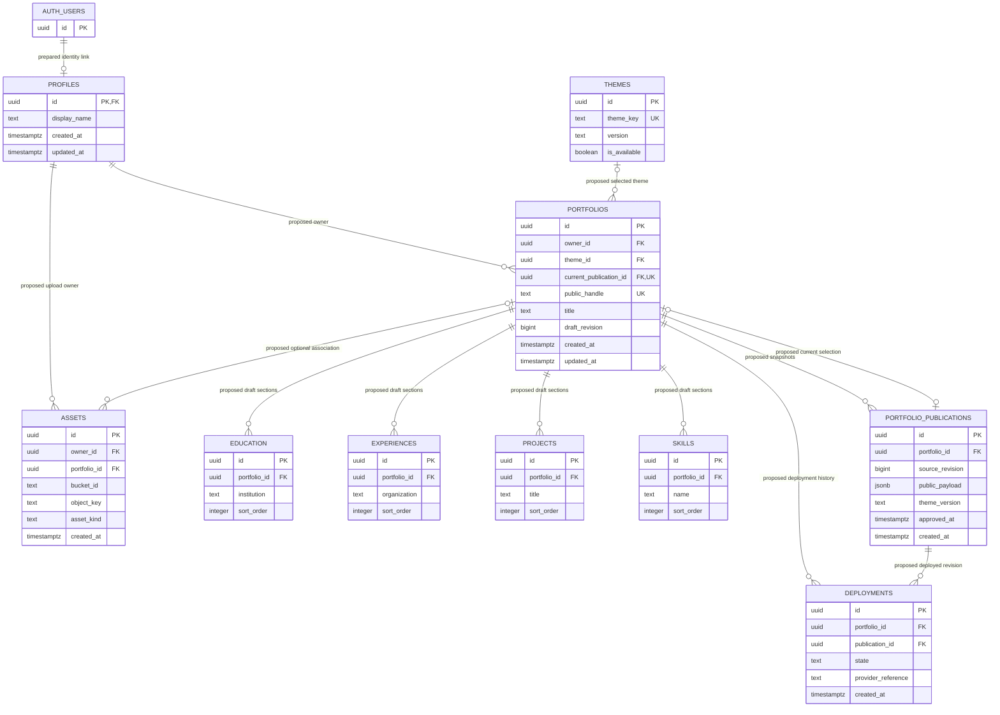

# Proposed database ERD

**Status: Proposed; Awaiting Supervisor Review. Not approved or implemented.**

See the [design](revised-database-design.md), [source mapping](database-requirement-mapping.md),
[access matrix](proposed-rls-access-matrix.md), and [decisions](database-design-decisions.md).

## Legend

`AUTH_USERS` represents managed `auth.users`, not a table to create. `PROFILES`
reflects the existing prepared migration. All other entities and attributes are
proposed physical representations. Domain support does not approve these columns.
`PORTFOLIO_PUBLICATIONS` is an additional architectural proposal for the confirmed
approval/publication workflow. Relationship labels identify prepared versus
proposed links. PK, FK, and UK mean primary, foreign, and unique keys.

Mermaid `||` means exactly one, `o|` zero or one, and `o{` zero or many.
Nullability and constraints not expressible in the diagram are specified below.

## Relationship constraints and qualifications

| Relationship                        | Proposed constraint or existing evidence                                                                                                                                                              |
| ----------------------------------- | ----------------------------------------------------------------------------------------------------------------------------------------------------------------------------------------------------- |
| Auth → profile                      | Existing profile PK/FK shares Auth UUID, `ON DELETE CASCADE`. Diagram allows zero profiles because the FK alone does not require one; prepared trigger/backfill aim for one profile per Auth account. |
| Profile → portfolios                | Each portfolio has one non-null owner; a profile may have none or many. Owner is immutable.                                                                                                           |
| Portfolio → CV sections             | Each section row has exactly one non-null portfolio FK; no independent owner field.                                                                                                                   |
| Theme → portfolios                  | Portfolio theme FK is nullable during drafting. A reusable catalogue theme can serve many portfolios; require an available theme before publication.                                                  |
| Profile → assets                    | Every asset has one non-null upload owner, including unassociated uploads.                                                                                                                            |
| Portfolio → assets                  | An asset has zero or one portfolio; a portfolio has zero or many assets. Enforce owner equality whenever associated.                                                                                  |
| Portfolio → publications            | Each immutable snapshot belongs to exactly one portfolio. Draft-only portfolios have no snapshots.                                                                                                    |
| Current publication                 | Nullable unique pointer on portfolio; a snapshot can be current for zero or one portfolio. Enforce that it belongs to the selecting portfolio. This is separate from snapshot ownership.              |
| Portfolio/publication → deployments | Every proposed deployment references one portfolio and one of that portfolio's publications. Both can have many attempts; enforce matching portfolio IDs.                                             |

Proposed nullability: all shown FKs are required except `portfolios.theme_id`,
`portfolios.current_publication_id`, and `assets.portfolio_id`. `public_handle`
is nullable before publication; enforce unique canonical non-null values.
`profiles.display_name` remains nullable as already defined. Other proposed field
nullability must be finalized with the content contracts.

Additional proposed constraints: unique `(bucket_id, object_key)` for asset identity;
positive draft revisions; nonnegative sort positions. Use composite foreign keys
with supporting unique keys or an equivalent reviewed constraint mechanism for
same-portfolio publication/deployment links. A simple pair of independent FKs
does not prove that those rows belong together. Asset owner equality likewise
requires a constraint/controlled operation as well as RLS.

The circular portfolio/publication reference requires deliberate migration ordering
and deletion semantics. It is not executable DDL. Theme catalogue versioning,
approval actor/audit records, public media representation, and account deletion
behavior remain [open decisions](database-design-decisions.md).
